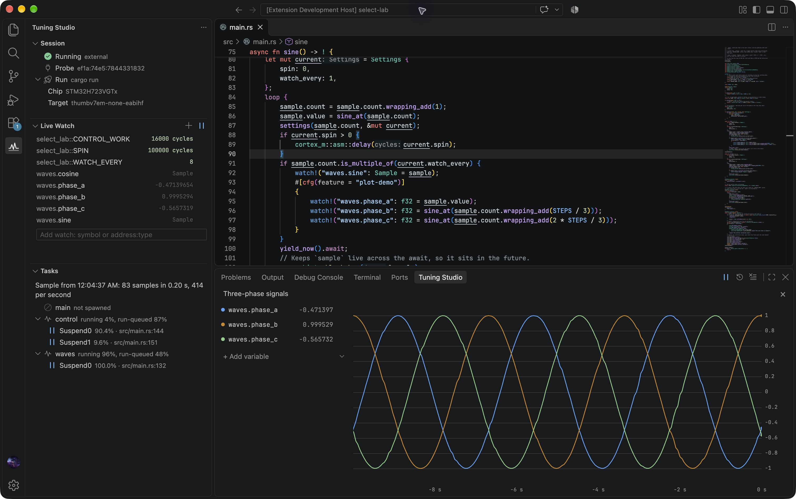

<h1 align="center">Tuning Studio</h1>
<p align="center">Read, watch and tune running embedded firmware over SWD.</p>
<p align="center">
  <a href="rust-toolchain.toml"></a>
  <a href="Cargo.toml"></a>
  <a href="#license"></a>
</p>
<p align="center">
  <a href="extensions/vscode">VS Code extension</a> ·
  <a href="crates/tuning-studio-cli">CLI</a> ·
  <a href="crates/tuning-studio-api">Firmware API</a> ·
  <a href="crates/studio-dwarf">DWARF library</a> ·
  <a href="firmware">Lab firmware</a>
</p>



Live data from an STM32H723 over SWD. The [plot demo](firmware/select-lab#plot-demo)
publishes three phase-shifted waves alongside the lab's Embassy tasks.

The [native desktop app](crates/tuning-studio-desktop) provides Live Watch and a
multi-value plot with zoom and pan. It includes inline edits, expandable fields,
autocomplete, and halt/resume controls.
Build it with `cargo build --locked -p tuning-studio-cli -p tuning-studio-desktop`,
then run `target/debug/tuning-studio-desktop`. Select the matching firmware ELF
and connect to a probe. It shares the existing CLI backend and firmware API.

The [VS Code extension](extensions/vscode) adds Live Watch, Embassy task samples,
and a numeric plotter. It connects to a CLI session started in your terminal
and can read the ELF path from a probe-rs launch configuration for offline suggestions. See the
[control training integration](extensions/vscode/examples/control-training-template.md)
for an example using existing PID fields and `watch_mut!`.

`tuning-studio` reads variables out of a running microcontroller by name,
without halting it. It finds each symbol in the ELF's DWARF,
decodes structs, enums, arrays and pointers, and reads them through a
[probe-rs](https://probe.rs) debug probe while the core keeps running. The
`tuning-studio-api` crate adds two things a debugger cannot give firmware on
its own: values the host can always read whole, and parameters the firmware
changes itself, within limits it declares.

```text
$ tuning-studio values
tune_lab::KP: f32 = 0.02 (default 0.02, 0.0 to 1.0)
tune_lab::SETPOINT: f32 = 100.0 rad/s (default 100.0, -300.0 to 300.0)
motor.speed: f32 = 91.16411 rad/s
motor.state: MotorSnapshot
  speed: f32 = 91.17929
  ticks: u64 = 1123
  pi: PiSnapshot
    integral: f32 = 0.12814881
    saturated: bool = false

$ tuning-studio set tune_lab::SETPOINT 120
tune_lab::SETPOINT: f32 = 120.0 rad/s (default 100.0, -300.0 to 300.0)
```

| Task | Tuning Studio provides |
| --- | --- |
| Inspect state | `read` and `watch` on symbol paths such as `CONTROL.yaw.gains[2]`, or on raw addresses with a type, and `trace`, which records every write to a value |
| Tune a controller | `Param`s with a range, changed with `set`, which waits for the firmware's reply |
| Watch async code | `watch!` values that are never torn, and `tasks`, which profiles each Embassy task |
| Run firmware | `run` as a Cargo runner: flash, reset, then print RTT and defmt logs |
| Debug | `halt`, `resume`, `step`, hardware breakpoints, and a GDB server |
| Work from scripts | A `run` or `attach` session keeps the probe, and every other command reaches it over a local socket |

## Quickstart

Build the CLI and VS Code extension from source for now. You need Git,
[Rust](https://rustup.rs/) with the toolchain in `rust-toolchain.toml`,
Node.js 22 or newer with npm, VS Code, and a probe supported by
[probe-rs](https://probe.rs). The CLI and extension currently support macOS
and Linux. On Linux, install the probe-rs
[udev rules](https://probe.rs/docs/getting-started/probe-setup/) for your probe.

### 1. Build and install the tools

```sh
git clone https://github.com/hxyulin/tuning-studio.git
cd tuning-studio
cargo install --path crates/tuning-studio-cli --locked

cd extensions/vscode
npm ci
npm run package
code --install-extension tuning-studio-0.2.0-rc.1.vsix
```

The CLI installs as `tuning-studio`. Make sure it is on the `PATH` VS Code
uses, or set `tuningStudio.executable` to its absolute path. If the `code`
command is unavailable, use **Extensions: Install from VSIX...** in VS Code
and select `extensions/vscode/tuning-studio-0.2.0-rc.1.vsix` from your checkout.

### 2. Expose firmware values

Add the `no_std` API to your firmware's `Cargo.toml` and keep debug information
in its ELF, including release builds:

```toml
[dependencies]
tuning-studio-api = { git = "https://github.com/hxyulin/tuning-studio" }

[profile.release]
debug = 2
strip = "none"
```

The API needs a `critical-section` implementation. Use the one your firmware
already provides, such as Embassy's, or enable `cortex-m`'s
`critical-section-single-core` feature on a single-core Cortex-M target.

Choose how to expose each value:

| API | Use it for | How edits work |
| --- | --- | --- |
| `watch!` | Read-only telemetry, including snapshots of structs | Publishes a copy each time the firmware calls it; the host cannot edit it |
| `watch_mut!` | Testing or tuning an existing scalar local or field | Applies a pending edit through your mutable reference, then publishes the value |
| `params!` / `Param` | Configuration such as setpoints and PID gains | `get()` applies host requests within the declared range |

For example, in a control loop:

```rust
use tuning_studio_api::{params, watch, watch_mut};

params! {
    static SETPOINT: f32 = 100.0, range = -300.0..=300.0, unit = "rad/s";
    static KP: f32 = 0.02, range = 0.0..=1.0;
}

// Call once per control tick with the controller's existing integral field.
fn control_tick(speed: f32, integral: &mut f32, dt: f32) -> f32 {
    // Apply an edit here, before using the local. Without an edit, only publish it.
    watch_mut!("motor.integral": f32 = integral);

    let error = SETPOINT.get() - speed;
    *integral += error * dt;
    watch!("motor.speed": f32 = speed, unit = "rad/s");
    watch!("motor.error": f32 = error, unit = "rad/s");

    KP.get() * error + *integral
}
```

The host can read the last `watch!` snapshot even while the task is suspended.
`watch_mut!` keeps the variable in your controller; for a field, pass
`&mut controller.integral`. An edit takes effect once at the next macro call,
and later firmware code can change it again. It supports `f32`, `bool`, and
8-, 16-, and 32-bit integers, with no range limits. Use a unique name
and a separate macro call site for each value you expose.

Call each parameter's `get()` where the control loop can apply a pending edit.
For flash integration, mark parameters with `persist = true`,
restore values at boot with `restore`, and save `last()` under its generated
`persistence_id()` through your firmware store. IDs are for tuning snapshots;
parameter declaration changes can invalidate them. The API does not perform flash writes.
See the [firmware API guide](crates/tuning-studio-api) for struct snapshots,
editable locals, and optional Embassy trace hooks.

### 3. Connect, watch, and tune in VS Code

Build firmware with your project's normal build command. Start a tuning session
in a terminal, using your board's chip and ELF:

```sh
tuning-studio run --chip STM32H723VGTx path/to/firmware.elf
```

To attach to firmware already running without flashing, use `tuning-studio attach`
with the same arguments. Stop any probe-rs debug session first; sharing its probe
connection is not implemented yet. Leave the terminal running and open
**Tuning Studio** in VS Code. The extension finds the session automatically.
Use Ctrl+C in the session's terminal to end it.

The extension focuses on tuning. It does not build, flash, or control the session's
lifetime. For offline watch suggestions, set `tuningStudio.elf` or select a
probe-rs launch configuration whose `coreConfigs[0].programBinary` names the ELF.

- **Live Watch** discovers `params!`, `watch!`, and `watch_mut!` values.
  Click a writable value to edit it inline, Enter to submit, or Escape to
  cancel. Read-only and unavailable values are dimmed; clicking one explains
  the reason and offers a source suggestion where applicable.
- **Plot** overlays up to eight numeric variables. Choose **+ Add variable**
  in the plot's left-hand list, click a variable to hide or show it, and hover
  to reveal its remove button.
- **Tasks** samples Embassy task states when you click **Sample Tasks**.
  Click a state with a source location to open its await point. This sampler
  does not require enabling the API's optional Embassy trace hooks.

The [extension guide](extensions/vscode) covers Run settings and UI behavior.
The [control training integration](extensions/vscode/examples/control-training-template.md)
shows how to expose existing PID fields with `watch_mut!` and use a custom
build task.

You can also use the CLI while the session runs, without repeating the chip
or ELF:

```sh
tuning-studio values
tuning-studio watch motor.speed motor.error
tuning-studio set motor.integral 0.0
# Replace my_firmware with your crate's module path.
tuning-studio set my_firmware::SETPOINT 120
tuning-studio tasks --duration 2000
```

Run `tuning-studio list` to list probes. You can also configure
`tuning-studio run --chip <chip>` as your Cargo runner, then use
`cargo run --release` to build, flash, and start a session. See the
[CLI guide](crates/tuning-studio-cli) for all commands.

## Crates

| Crate | What it is |
| --- | --- |
| [`tuning-studio-cli`](crates/tuning-studio-cli) | The `tuning-studio` command |
| [`tuning-studio-api`](crates/tuning-studio-api) | `no_std` firmware crate with `watch!`, `watch_mut!`, `Param` and `params!` |
| [`tuning-studio-api-macros`](crates/tuning-studio-api-macros) | `#[derive(Watchable)]`, re-exported by `tuning-studio-api` |
| [`tuning-studio-dwarf`](crates/studio-dwarf) | ELF symbols, DWARF types and Embassy task layouts |

## Lab firmware

Each directory under [`firmware/`](firmware) is a standalone STM32H723 project
that checks one part of the CLI on hardware. Their READMEs record the
measurements.

| Lab | Checks |
| --- | --- |
| [type-lab](firmware/type-lab) | Reads and writes of every value shape: integers, floats, enums, `Option`, unions, pointers, slices |
| [log-lab](firmware/log-lab) | RTT text and defmt logs, and panics caught by `run` |
| [tune-lab](firmware/tune-lab) | `Param`, `watch!`, and `watch_mut!` on a PI loop driving a simulated motor |
| [select-lab](firmware/select-lab) | Reading async state under `select`, read rates, and the `tasks` profiler |

Tuning Studio has been tested on an STM32H723 with a CMSIS-DAP probe. Other
chips that probe-rs supports should work, but have not been tried.

## Development

```sh
cargo test --workspace
cargo clippy --workspace --all-targets -- -D warnings
cargo fmt --check
```

The CLI's tests read ELFs in `crates/tuning-studio-cli/tests/fixtures`, copied
from the labs. Each lab's README shows how to refresh its copy.

The `legacy` branch holds the earlier Tauri app and VS Code extension.

## License

Tuning Studio is available under either the [MIT license](LICENSE-MIT) or the
[Apache License 2.0](LICENSE-APACHE), at your option.
`tuning-studio-dwarf` was ported from `datavis-rs` and is MIT licensed only.
